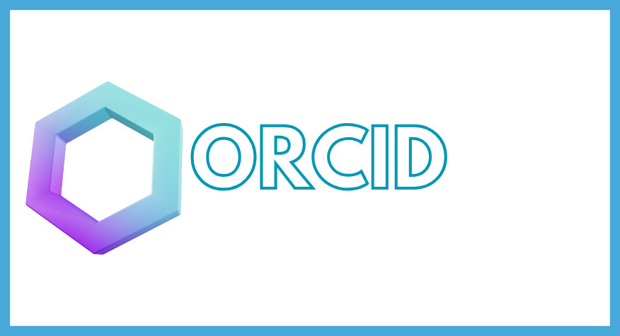

  
  &nbsp;
  

  
  &nbsp;
  

  
| | | | | | | |
| :-: | :-: | :-: | :-: | :-: | :-: | :-: |
|  **MySQL** |  **JavaScript** |  **Kuma** |  **MariaDB** |  **Cinny** |  **Squid Proxy** |  **Ubuntu** |
|  **Docker** |  **Markdown** |  **Ansible** |  **SSH** |  **Prometheus** |  **Netdata** |  **Debian** |
|  **Linux** |  **OpenVPN** |  **Kea** |  **JSON** |  **Grafana** |  **LDAP** |  **Red Hat** |
|  **GitHub** |  **Windows** |  **Proxmox** |  **YAML** |  **Certbot** |  **RAID** |  **Kali Linux** |
|  **NGINX** |  **WordPress** |  **PHP** |  **Hosting** |  **Webhooks** |  **NFTables** |  **Arch Linux** |
|  **Kubernetes** |  **Bash/Shell** |  **Nmap** |  **Workflows** |  **Fail2Ban** |  **NTFS** |  **Linux Mint** |
|  **Apache2** |  **PowerShell** |  **Keepalived** |  **Matrix** |  **phpMyAdmin** |  **FTP** |  **Xubuntu** |
|  **HTML5** |  **OPNsense** |  **UFW** |  **Nextcloud** |  **Traefik** |  **DHCP** |  **Whonix** |
|  **CSS3** |  **Zabbix** |  **WireGuard** |  **Semaphore** |  **Bind9** |  **SSL** |  **Rescatux** |

