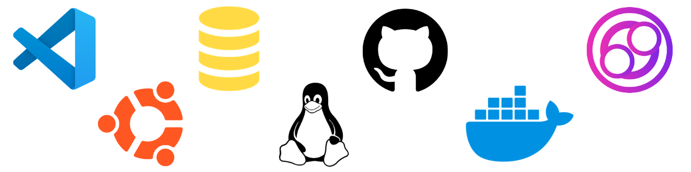
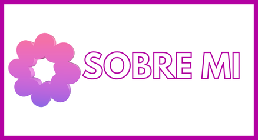
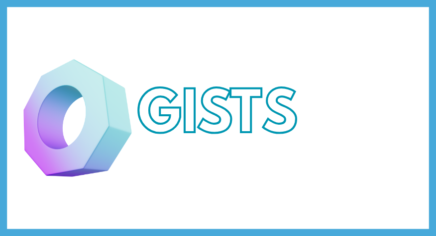

  
  &nbsp;
  

  
  &nbsp;
  

  <table style="border: none; border-collapse: collapse; margin: 0 auto; width: 100%; max-width: 1560px; line-height: 36px;" cellspacing="0" cellpadding="8">
    <tr style="border: none;">
      <td style="border: none; font-size: 18px; text-align: left; white-space: nowrap;"> <strong>MySQL</strong></td>
      <td style="border: none; font-size: 18px; text-align: left; white-space: nowrap;"> <strong>JavaScript</strong></td>
      <td style="border: none; font-size: 18px; text-align: left; white-space: nowrap;"> <strong>Kuma</strong></td>
      <td style="border: none; font-size: 18px; text-align: left; white-space: nowrap;"> <strong>MariaDB</strong></td>
      <td style="border: none; font-size: 18px; text-align: left; white-space: nowrap;"> <strong>Cinny</strong></td>
      <td style="border: none; font-size: 18px; text-align: left; white-space: nowrap;"> <strong>Squid Proxy</strong></td>
      <td style="border: none; font-size: 18px; text-align: left; white-space: nowrap;"> <strong>Ubuntu</strong></td>
    </tr>
    <tr style="border: none;">
      <td style="border: none; font-size: 18px; text-align: left; white-space: nowrap;"> <strong>Docker</strong></td>
      <td style="border: none; font-size: 18px; text-align: left; white-space: nowrap;"> <strong>Markdown</strong></td>
      <td style="border: none; font-size: 18px; text-align: left; white-space: nowrap;"> <strong>Ansible</strong></td>
      <td style="border: none; font-size: 18px; text-align: left; white-space: nowrap;"> <strong>SSH</strong></td>
      <td style="border: none; font-size: 18px; text-align: left; white-space: nowrap;"> <strong>Prometheus</strong></td>
      <td style="border: none; font-size: 18px; text-align: left; white-space: nowrap;"> <strong>Netdata</strong></td>
      <td style="border: none; font-size: 18px; text-align: left; white-space: nowrap;"> <strong>Debian</strong></td>
    </tr>
    <tr style="border: none;">
      <td style="border: none; font-size: 18px; text-align: left; white-space: nowrap;"> <strong>Linux</strong></td>
      <td style="border: none; font-size: 18px; text-align: left; white-space: nowrap;"> <strong>OpenVPN</strong></td>
      <td style="border: none; font-size: 18px; text-align: left; white-space: nowrap;"> <strong>Kea</strong></td>
      <td style="border: none; font-size: 18px; text-align: left; white-space: nowrap;"> <strong>JSON</strong></td>
      <td style="border: none; font-size: 18px; text-align: left; white-space: nowrap;"> <strong>Grafana</strong></td>
      <td style="border: none; font-size: 18px; text-align: left; white-space: nowrap;"> <strong>LDAP</strong></td>
      <td style="border: none; font-size: 18px; text-align: left; white-space: nowrap;"> <strong>Red Hat</strong></td>
    </tr>
    <tr style="border: none;">
      <td style="border: none; font-size: 18px; text-align: left; white-space: nowrap;"> <strong>GitHub</strong></td>
      <td style="border: none; font-size: 18px; text-align: left; white-space: nowrap;"> <strong>Windows</strong></td>
      <td style="border: none; font-size: 18px; text-align: left; white-space: nowrap;"> <strong>Proxmox</strong></td>
      <td style="border: none; font-size: 18px; text-align: left; white-space: nowrap;"> <strong>YAML</strong></td>
      <td style="border: none; font-size: 18px; text-align: left; white-space: nowrap;"> <strong>Certbot</strong></td>
      <td style="border: none; font-size: 18px; text-align: left; white-space: nowrap;"> <strong>RAID</strong></td>
      <td style="border: none; font-size: 18px; text-align: left; white-space: nowrap;"> <strong>Kali Linux</strong></td>
    </tr>
    <tr style="border: none;">
      <td style="border: none; font-size: 18px; text-align: left; white-space: nowrap;"> <strong>NGINX</strong></td>
      <td style="border: none; font-size: 18px; text-align: left; white-space: nowrap;"> <strong>WordPress</strong></td>
      <td style="border: none; font-size: 18px; text-align: left; white-space: nowrap;"> <strong>PHP</strong></td>
      <td style="border: none; font-size: 18px; text-align: left; white-space: nowrap;"> <strong>Hosting</strong></td>
      <td style="border: none; font-size: 18px; text-align: left; white-space: nowrap;"> <strong>Webhooks</strong></td>
      <td style="border: none; font-size: 18px; text-align: left; white-space: nowrap;"> <strong>NFTables</strong></td>
      <td style="border: none; font-size: 18px; text-align: left; white-space: nowrap;"> <strong>Arch Linux</strong></td>
    </tr>
    <tr style="border: none;">
      <td style="border: none; font-size: 18px; text-align: left; white-space: nowrap;"> <strong>Kubernetes</strong></td>
      <td style="border: none; font-size: 18px; text-align: left; white-space: nowrap;"> <strong>Bash/Shell</strong></td>
      <td style="border: none; font-size: 18px; text-align: left; white-space: nowrap;"> <strong>Nmap</strong></td>
      <td style="border: none; font-size: 18px; text-align: left; white-space: nowrap;"> <strong>Workflows</strong></td>
      <td style="border: none; font-size: 18px; text-align: left; white-space: nowrap;"> <strong>Fail2Ban</strong></td>
      <td style="border: none; font-size: 18px; text-align: left; white-space: nowrap;"> <strong>NTFS</strong></td>
      <td style="border: none; font-size: 18px; text-align: left; white-space: nowrap;"> <strong>Linux Mint</strong></td>
    </tr>
    <tr style="border: none;">
      <td style="border: none; font-size: 18px; text-align: left; white-space: nowrap;"> <strong>Apache2</strong></td>
      <td style="border: none; font-size: 18px; text-align: left; white-space: nowrap;"> <strong>PowerShell</strong></td>
      <td style="border: none; font-size: 18px; text-align: left; white-space: nowrap;"> <strong>Keepalived</strong></td>
      <td style="border: none; font-size: 18px; text-align: left; white-space: nowrap;"> <strong>Matrix</strong></td>
      <td style="border: none; font-size: 18px; text-align: left; white-space: nowrap;"> <strong>phpMyAdmin</strong></td>
      <td style="border: none; font-size: 18px; text-align: left; white-space: nowrap;"> <strong>FTP</strong></td>
      <td style="border: none; font-size: 18px; text-align: left; white-space: nowrap;"> <strong>Xubuntu</strong></td>
    </tr>
    <tr style="border: none;">
      <td style="border: none; font-size: 18px; text-align: left; white-space: nowrap;"> <strong>HTML5</strong></td>
      <td style="border: none; font-size: 18px; text-align: left; white-space: nowrap;"> <strong>OPNsense</strong></td>
      <td style="border: none; font-size: 18px; text-align: left; white-space: nowrap;"> <strong>UFW</strong></td>
      <td style="border: none; font-size: 18px; text-align: left; white-space: nowrap;"> <strong>Nextcloud</strong></td>
      <td style="border: none; font-size: 18px; text-align: left; white-space: nowrap;"> <strong>Traefik</strong></td>
      <td style="border: none; font-size: 18px; text-align: left; white-space: nowrap;"> <strong>DHCP</strong></td>
      <td style="border: none; font-size: 18px; text-align: left; white-space: nowrap;"> <strong>Whonix</strong></td>
    </tr>
    <tr style="border: none;">
      <td style="border: none; font-size: 18px; text-align: left; white-space: nowrap;"> <strong>CSS3</strong></td>
      <td style="border: none; font-size: 18px; text-align: left; white-space: nowrap;"> <strong>Zabbix</strong></td>
      <td style="border: none; font-size: 18px; text-align: left; white-space: nowrap;"> <strong>WireGuard</strong></td>
      <td style="border: none; font-size: 18px; text-align: left; white-space: nowrap;"> <strong>Semaphore</strong></td>
      <td style="border: none; font-size: 18px; text-align: left; white-space: nowrap;"> <strong>Bind9</strong></td>
      <td style="border: none; font-size: 18px; text-align: left; white-space: nowrap;"> <strong>SSL</strong></td>
      <td style="border: none; font-size: 18px; text-align: left; white-space: nowrap;"> <strong>Rescatux</strong></td>
    </tr>
    <!-- Slots extra: de reserva
    <tr style="border: none;">
      <td style="border: none; font-size: 18px; text-align: left; white-space: nowrap;"> <strong>Tecnología</strong></td>
      <td style="border: none; font-size: 18px; text-align: left; white-space: nowrap;"> <strong>Tecnología</strong></td>
      <td style="border: none; font-size: 18px; text-align: left; white-space: nowrap;"> <strong>Tecnología</strong></td>
      <td style="border: none; font-size: 18px; text-align: left; white-space: nowrap;"> <strong>Tecnología</strong></td>
      <td style="border: none; font-size: 18px; text-align: left; white-space: nowrap;"> <strong>Tecnología</strong></td>
      <td style="border: none; font-size: 18px; text-align: left; white-space: nowrap;"> <strong>Tecnología</strong></td>
      <td style="border: none; font-size: 18px; text-align: left; white-space: nowrap;"> <strong>Tecnología</strong></td>
    </tr>
    -->
  </table>

